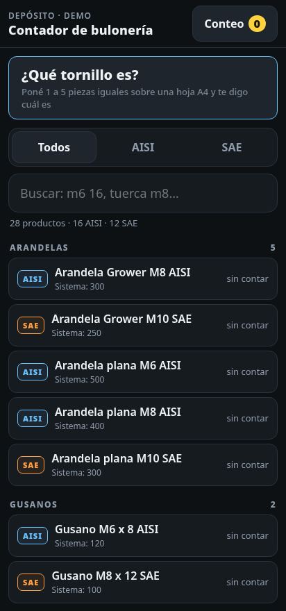

# Contador de bulonería 🔩📷

PWA para el celular que **cuenta tuercas, bulones y tornillos con la cámara** (o por peso) para controlar el stock de un depósito, **sin conexión** y sin instalar nada.

🟢 **Probala en vivo:** https://ttt13412014.github.io/contador-buloneria/
_Abrila desde el celular (Chrome/Android o Safari/iPhone) y dale permiso a la cámara. Se puede "Agregar a la pantalla de inicio" y anda offline._

<p align="center"></p>

## ¿Por qué?

Hacer el conteo de inventario de bulonería a mano (cientos de piezas chicas, iguales, en cajas) es lento y propenso a errores. La idea: volcar las piezas sobre una **hoja A4** (que sirve de referencia de escala), sacar una foto y que el celular las cuente; o pesar el lote y dividir por el peso unitario.

Nació para el depósito donde trabajo en logística. **Esta versión pública usa un catálogo de ejemplo inventado**: no contiene la lista ni el stock real de ninguna empresa.

## Funcionalidades

- 📷 **Conteo en vivo con la cámara**, que marca en colores las piezas OK, las amontonadas y las de otro largo.
- 📄 **Hoja A4 como referencia de escala** y uso de la linterna del teléfono.
- 🔍 **"¿Qué tornillo es?"**: ponés 1 a 5 piezas iguales sobre la hoja y estima la medida (diámetro, largo, tipo de cabeza) y te sugiere el producto del catálogo.
- ⚖️ **Modo balanza**: calibración con peso por unidad y tara.
- 🗂️ Catálogo con búsqueda (`m6 16`, `tuerca m8`…), filtros AISI / SAE y agrupado por familia.
- 📊 Diferencia contra el stock del sistema; exportación a **CSV** y **WhatsApp**.
- 📴 **Funciona offline** (service worker) y guarda el conteo en el teléfono.

## Cómo funciona la visión artificial

Todo corre en el navegador, con un pipeline **hecho a mano en JavaScript, sin OpenCV ni librerías**:

1. Escala de grises y desenfoque (blur) para sacar ruido.
2. **Umbral de Otsu** para separar piezas del fondo blanco de la hoja.
3. **Morfología** (erosión/dilatación) para limpiar la máscara.
4. **Detección de contornos** y componentes conectados.
5. Estimación del área típica de una pieza para **estimar cuántas hay en los grupos que se tocan**.
6. La hoja A4 detectada da la escala en milímetros para medir las piezas.

## Stack

- HTML + CSS + JavaScript puro, **un solo `index.html`** (~80 KB) sin dependencias ni build.
- `getUserMedia` (cámara), Canvas 2D, Service Worker, `localStorage`.
- Hosting estático: GitHub Pages (también probado en Netlify).

## Cómo usarlo con tu catálogo

El catálogo está en `index.html`, en la constante `RAW`: una línea por producto con el formato `Nombre|stock`, separado en AISI y SAE. Reemplazalo por el tuyo.

## Correrlo localmente

```bash
python3 -m http.server 8000
# abrí http://localhost:8000
```

> La cámara necesita HTTPS o `localhost`.

## Estado

Funcional; falta probarlo a fondo con más tipos de piezas reales y distintas condiciones de luz.

---

Hecho por [Lucas](https://github.com/ttt13412014) · Córdoba, Argentina
